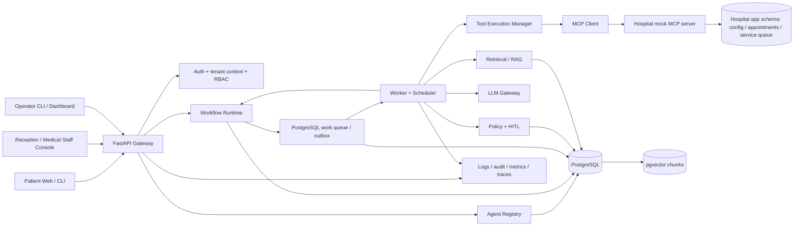
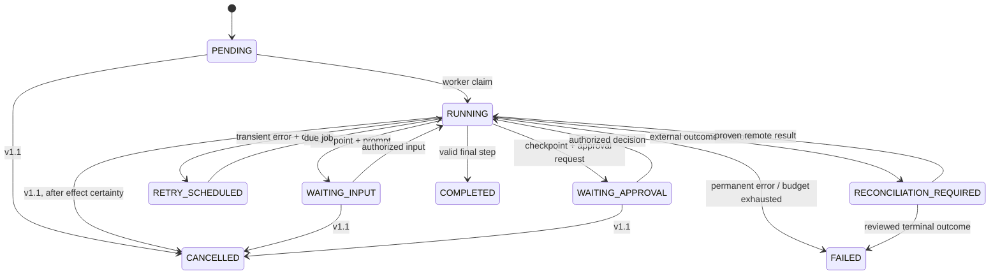
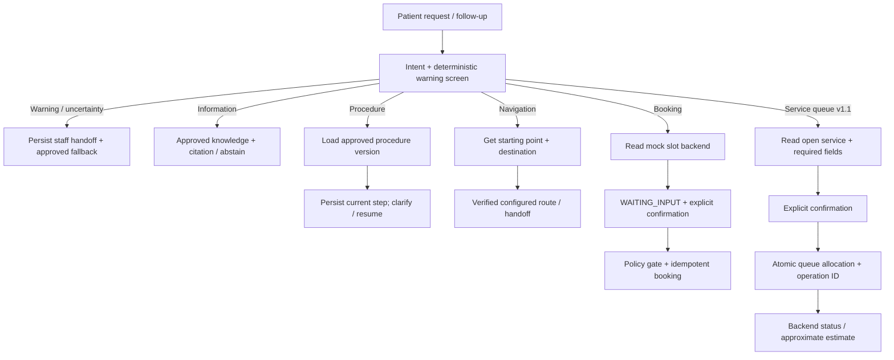

# High-Level Design — Hospital Agent Platform

**Version:** 1.1 (proposed; updated for hospital functionality)  
**Requirements source:** [requirement.md](requirement.md), version 1.0  
**Scope:** target architecture and release path from MVP v1.0 through Reliability v1.1 to Platform v2.0  
**Status:** proposed for review; the decisions in section 13 need ADRs and low-level design before implementation

## 1. Goals and principles

The platform is a reusable agent execution engine; Hospital Front Desk is its first reference application. The core understands agents, workflows, executions, tools, policies, and tenants. Hospital profiles, procedures, locations, appointments, service queues, and handoffs belong to the hospital application and mock MCP server. The MVP uses synthetic data only and does not provide diagnosis, prescriptions, or autonomous emergency triage.

Design invariants:

1. The API returns `202 Accepted` only after the execution and work intent have been committed to PostgreSQL.
2. Each execution pins an immutable set of workflow, prompt, model, policy, and tool-contract versions from creation through completion.
3. Every state transition uses a `version` compare-and-swap (CAS) check; the checkpoint, event, and work intent commit in one transaction.
4. Work is delivered **at least once**. The platform does not claim exactly-once execution; stable operation IDs, remote idempotency, and reconciliation bound duplicate side effects.
5. Server-side policy checks precede every tool call and are independent of prompts and LLM decisions.
6. Tenant identity and actor permissions are checked at every entry point; from v1.1, workers also revalidate tenant ownership before effects and commits.
7. A step awaiting patient or staff input releases its worker slot. Its checkpoint is persisted before the waiting status is reported.

## 2. Release scope

| Capability | MVP v1.0 | Reliability v1.1 | Platform v2.0 |
|---|---|---|---|
| Runtime | One deployment with local workers; PostgreSQL queue/outbox, checkpoints, delayed retries, restart recovery | Multiple replicas, leases/heartbeats/fencing, cancellation, general scheduling, dead-letter handling, operator recovery | Priorities/fairness, multi-agent handoffs, sagas |
| AI | LLM adapter, schema-validated outputs, cited RAG with abstention, separate conversation memory | Token/cost reporting, context budgets, tracing | Model routing/fallback, hybrid retrieval, long-term memory |
| Governance | Agent versions, tool allowlists, policy, minimal staff approval and handoff | Tenants/memberships/quotas, case resolution, rate limits, circuit breakers | Tenant lifecycle and expanded governance |
| Hospital | Sourced hospital information, multi-step procedure guidance, static navigation, mock booking, handoffs | Mock service queue and status, appointment changes, advanced navigation, case management | Interactive maps, multilingual and spoken responses, sandbox scheduling connector |

v1.1 and v2.0 are planned extensions, not implicit MVP features. The application provides general administrative guidance with synthetic data; it does not provide medical advice or make clinical decisions.

## 3. Architecture

**MVP deployment:** The API, scheduler/dispatcher, and workers may run in one Docker Compose service or process group. They remain separate modules so restart and fault-injection behavior can be tested. PostgreSQL is the source of truth; Redis and a telemetry backend are optional. v1.1 may run multiple API and worker replicas against the same database after leases, fencing, and distributed admission and quotas are added.

### 3.1 Module boundaries

| Module | Responsibilities | Does not own |
|---|---|---|
| API/Auth | Authentication, patient-session ownership, tenant context, RBAC, HTTP schemas, admission, status and event responses | Workflow execution or durable state in memory |
| Registry | Validate and store immutable agent configuration snapshots; resolve versions within a tenant | Changes to configuration used by a running execution |
| Runtime | State machine, transition CAS, checkpoints, events, step attempts, retries, and timeouts | Side effects that bypass the tool manager |
| Queue/Scheduler | Persist work intents, claim due jobs, redispatch after restart | Execution state in place of PostgreSQL |
| LLM Gateway | Provider adapters, timeouts, output schemas; usage and budgets from v1.1 | Tool authorization |
| Retrieval/Memory | Approved hospital information and procedure chunks, tenant filters, provenance and citations; conversations separate from execution state | Instructions that override policy |
| Policy/HITL | Allowlists, sensitive actions, approvals, warning-indicator rules, audit | Treating an LLM decision as authorization |
| Tool Manager/MCP | Validate arguments and results, classify errors, assign operation IDs, reconcile side effects | Declaring success when a remote outcome is uncertain |
| Hospital app | Domain workflows, prompts, policies, versioned profiles/procedures/locations, handoffs, mock slots/appointments, and service queues from v1.1 | Hospital domain models in the platform core |

## 4. Execution contract and lifecycle

`execution_id` identifies a run; `step_id` identifies a workflow node; `attempt_id` identifies one attempt; `operation_id` remains stable for **one logical business action** across retries and restarts; `trace_id` links telemetry. A new action must get a new `operation_id`.

`COMPLETED` and `FAILED` are terminal; `CANCELLED` becomes terminal in v1.1. `RECONCILIATION_REQUIRED` is an inspectable waiting state, not an inferred success or failure. In v1.1, an operator rerun creates a new execution linked to the original instead of reopening a terminal execution. The agent's versioned configuration defines valid transitions, per-step timeouts, and retry budgets; the runtime rejects invalid transitions.

### 4.1 Transaction boundaries

- **Execution creation:** Authenticate and authorize the request, then canonicalize and hash its payload. In one database transaction, insert or read `idempotency_records` by `(tenant_id, operation_type, key)`, create the execution with pinned versions, write the initial event and checkpoint, and insert the outbox/work intent. Return `202` only after commit. The same key and payload yield the same logical result or `IN_PROGRESS`; a different payload yields `409`.
- **Step transition:** Load the execution and its pinned configuration, make the step decision, then perform `UPDATE ... WHERE id = ? AND version = ?`. Write the checkpoint, step attempt, event, and next outbox record in the same transaction. On a CAS loss, reload and discard the stale decision; do not repeat a side effect merely because CAS failed.
- **Waiting for input or approval:** Commit the waiting state and valid input token or decision ID before reporting the prompt or approval request. Deduplicate repeated input or decisions, check authorization and state/version within one transaction, then enqueue the next step.
- **Delayed retry:** Persist `due_at`, the attempt and budget, and the work intent in PostgreSQL. The scheduler claims only due jobs, respecting `Retry-After` and jitter. A restart does not move a retry earlier than its due time.
- **Outbox:** The dispatcher reads unpublished records, publishes them at least once, and marks them published. A crash after commit or between publish and mark can produce duplicates. Consumers verify tenant, execution state/version, job ID, and attempt before proceeding. The MVP may claim jobs directly from the database; the outbox still defines the transaction boundary for work intents.

### 4.2 Side effects and uncertain outcomes

Before booking, the runtime durably records the `operation_id`, payload hash, and invocation status. The Tool Manager checks the allowlist, policy, approval, schema, timeout, and tenant. The mock MCP booking service accepts `(tenant_id, operation_id)`, enforces a unique constraint, returns the same result on repeats, and supports lookup by operation ID.

After a timeout or worker crash, recovery **looks up the operation ID first**. If the effect exists, it records the result and continues. If the effect is proven absent and retry is safe, it retries with the same operation ID. If the outcome cannot be determined, it enters `RECONCILIATION_REQUIRED` with minimal redacted context for review. A real tool without idempotency or reliable lookup must not have its side effect retried automatically.

v1.1 adds leases with `owner_id`, `expires_at`, and `fencing_token`. Heartbeats renew leases; a new worker claims a job only after expiry. Worker commits require CAS on both the execution version and current fencing token. Lease expiry does not prove that a remote effect did not occur, so the same reconciliation process still applies.

## 5. Hospital Front Desk workflows

The application classifies `information`, `procedure`, `navigation`, `booking`, `symptom`, and `support` intents. Ambiguous requests trigger clarification; configured warning indicators are screened before routine actions. Answers cite a source/version or disclose missing, stale, or unverifiable information. The LLM must not invent opening hours, fees, health-insurance benefits, rooms, routes, slots, or queue numbers.

### 5.1 Information, procedures, and navigation (v1.0)

- **Information:** Questions about hours, departments, services, registration documents, health-insurance procedures, and published fees are answered from approved hospital sources. Documents carry source ID, version, effective or last-updated date, and approval status. Retrieval supplies evidence only; missing or stale content triggers disclosure of uncertainty or handoff. Fees and insurance benefits are never inferred.
- **Procedures:** First-time and pre-booked registration procedures are ordered steps with conditions and required documents from an approved version. Checkpoints store `procedure_version`, `current_step`, and only the data needed to ask an intervening question, switch intent, and resume, including after restart. Configuration updates do not change the steps of an in-flight execution; a new journey may use the new version.
- **Static navigation:** Resolve the destination against approved building, floor, room, and counter data; ask for a starting point when needed. Build routes only from configured, currently valid links and waypoints. Never guess a room or route. v1.1 adds multi-building and accessible routes when configured; interactive floor maps arrive in v2.0.

### 5.2 Appointments and handoffs

Booking reads specialties, doctors, and slots from the mock scheduling service. A displayed slot is availability, not a reservation. After persisting `WAITING_INPUT`, the patient explicitly confirms, the runtime checks policy, and booking uses a stable `operation_id`. The mock service checks capacity in an atomic transaction with constraints; an expired or contested slot does not create a booking or produce a success message. A timeout is reconciled by operation ID before retry. In v1.1, viewing, rescheduling, and cancelling an appointment require patient ownership, a separate confirmation for each change, a distinct operation ID, policy checks, and audit. Hospital configuration defines the change rules.

A warning indicator stops autonomous booking, persists a handoff routed to the appropriate staff, and shows approved fallback guidance when no staff member is online. Medical staff retain responsibility for clinical decisions; the agent only screens for administrative escalation. In v1.1, authorized staff can assign, update, close, and reopen cases with an audit trail.

### 5.3 Hospital service queue (v1.1)

The **hospital service queue** issues and tracks patient service numbers; the **platform work queue** in section 4 dispatches jobs to workers. They have separate schemas, states, and access controls. Only an open service accepts registration. After collecting required fields and confirmation, the mock MCP service allocates a number in an atomic transaction within `(tenant_id, service_id, business_date, queue_scope)`. A unique constraint and transactional counter or lock prevent duplicate numbers under concurrent requests. Unique `(tenant_id, operation_id)` ensures at most one registration per logical request. After a worker crash or timeout, the system looks up the operation ID before retrying or reporting success.

A patient can read only registrations owned by their session. The currently serving number, assigned counter, and status come from the backend, not LLM inference. A closed or failing service issues no number and produces no success message. Approaching-turn notices and wait estimates are optional, use backend data, and label estimates as approximate.

## 6. Data and storage

PostgreSQL has the following logical boundaries, potentially within one database and separate schemas:

| Area | Main tables | Rules |
|---|---|---|
| Registry | `agents` and versioned configuration snapshots | Unique `(tenant_id, agent_id, version)`; published snapshots are immutable |
| Execution | `executions`, `execution_events`, `step_attempts`, `checkpoints` | CAS on `executions.version`; event sequence unique within an execution; state and checkpoints exclude full chat history |
| Work/reliability | `outbox_events`, durable jobs and due times, `idempotency_records`, `tool_invocations`; `worker_leases` from v1.1 | Unique scoped idempotency keys and operation IDs; indexes for due/uncompleted jobs; retention longer than the retry/replay window (seven days suggested for the demo) |
| Governance | `approvals`, `audit_records`, hospital staff handoffs | Actor, time, decision ID, policy result, outcome, and trace; redacted payloads |
| AI | `conversation_messages`, `knowledge_documents`, `knowledge_chunks`, `evaluation_runs` | Memory separate from execution state; source/version for citations; tenant-filtered pgvector retrieval from v1.1 |
| Tenant v1.1 | `tenants`, `tenant_memberships`, `tenant_quota_configs` | Context from session and membership; audited changes; last-admin protection |
| Hospital v1.0 | `hospital_profiles`, `hospital_departments`, `hospital_locations`, `hospital_procedures` and approved versions; `appointment_slots`, `appointments`, `handoff_cases` | Server-derived `tenant_id`; effective procedure/location data; patient ownership; slot capacity and unique `(tenant_id, operation_id)` in the mock service |
| Hospital v1.1 | `queue_services`, `queue_registrations`, `queue_status_events`; appointment-change rules and accessible routes | Unique number within hospital/service/date/scope; unique operation ID; backend status/ownership; separate from the platform work queue |

v1.0 writes a fixed `tenant_id` on every tenant-owned record. v1.1 adds tenant-scoped unique keys, composite foreign keys, and tenant-leading indexes so child records cannot reference another tenant's parents. RAG, memory, audit, tool lookup, and worker claims filter by tenant before returning data. A foreign resource ID yields `404`; a same-tenant resource with insufficient role yields `403`. Tenant admins see only their own audit records. Platform operators see tenant metadata by default; content access requires membership and is audited.

**Separation of concerns:** Execution state represents current business progress; conversation memory is LLM context that may be summarized or deleted; `execution_events` and audit are immutable, redacted history. Alembic migrations follow an expand-then-contract approach. Detailed per-data-type retention and deletion policies must be set in the low-level design before production use.

## 7. API and access contracts

The HTTP/JSON API in the requirements is the primary interface. `POST /agents/{agent_id}/executions` requires `Idempotency-Key` and returns `202` after durable commit. `GET /executions/{id}` and `/events` check ownership or role. `POST /input` uses an input event ID and expected version; `/approval` uses a decision ID and staff role. Only authorized staff may list or inspect hospital handoffs; medically sensitive handoffs route to appropriate medical staff. Mutations use the standard error shape `{error_code, message, trace_id, retry_after?, details?}` and consistent `400/401/403/404/409/422/429/500/503` semantics.

In v1.0, a synthetic patient session is bound to its own execution and cannot approve actions or inspect handoffs. Operators and staff must authenticate. In v1.1, the active tenant comes from an authenticated session and currently valid membership on **every request**; a tenant ID in the path must match that context. Revocation takes effect on the next request. A worker does not trust a tenant ID in a queue payload: it reloads the execution and agent configuration, then verifies tenant ownership before effects or commits. Appointment and service-queue actions use authorized domain tools rather than separate public mutation endpoints in the platform API; tool contracts must specify schemas, ownership, operation IDs, and reconciliation lookup. v1.1 SSE streams persisted events by sequence/cursor; reconnecting only rereads events and does not create an action.

## 8. Security, safety, and operations

- Secrets come from the environment or a secret store, never the repository or logs. Logs, events, traces, and audit redact sensitive content; audit retains actor, action, resource, policy result, outcome, and correlation IDs.
- API, LLM, and MCP inputs and outputs are schema-validated. LLM calls have timeouts and a bounded output-repair budget. Only declared step types call an LLM; every tool call passes a server-side policy gate and per-agent allowlist.
- Only synthetic data is used; answers are administrative guidance, not medical advice. The MVP safety gate runs a fixed, versioned warning-indicator suite, requires zero missed handoffs within that suite and zero unauthorized effects, and has a reviewer sign off on the results. This is not a claim of clinical sensitivity.
- Readiness checks database connectivity and minimum processing capability; liveness reflects process health only. Structured logs include applicable `trace_id`, `execution_id`, `step_id`, `attempt_id`, and `operation_id` values without raw patient input.
- v1.1 adds OpenTelemetry spans across API, runtime, LLM/MCP, and database; metrics for queue depth/age, worker occupancy, retries, errors, p50/p95/p99 latency, provider usage and cost; and a protected `/metrics` endpoint. Per-dependency circuit breakers and graceful shutdown stop intake, then drain or safely release leases.
- In v1.1, admission checks per-user, per-tenant, and global rate limits, queue depth, and resource budgets before durable acceptance. Across two replicas, counters/transactions or a distributed limiter provide atomic enforcement; one tenant cannot consume another's reserved capacity. Quota pressure returns `429`, service saturation returns `503`, and `Retry-After` is included when known.

## 9. Deployment and evolution

**MVP Docker Compose:** FastAPI service, workers and scheduler in one deployment, PostgreSQL with pgvector, a mock hospital MCP service with hospital information/procedure/location and appointment data, and an optional LLM stub. The suggested stack is Python 3.12+, Pydantic, SQLAlchemy, Alembic, and the official Python MCP SDK. Infrastructure tests use a fixed LLM stub; a real-model interactive demo is configured separately.

**v1.1:** Add the mock hospital service queue, appointment changes, advanced routes, API and worker replicas, leases/fencing, tenant-aware admission and quotas, a distributed limiter, circuit breakers, and a telemetry backend. Redis may serve as a cache, transport, or limiter, while PostgreSQL remains authoritative for executions, checkpoints, outbox, and retry due times. Worker and provider concurrency limits are independent.

**v2.0:** Add interactive maps, multilingual and spoken responses, a sandbox scheduling connector, and a supervisor for agent handoffs that carries the trace and scoped context. Sagas identify compensable and non-compensable steps. Model routing selects only providers that satisfy data and policy constraints. A second domain agent must use the existing registry, runtime, and API without core changes.

## 10. Verification and requirements traceability

| Design area | Representative requirement IDs | Required verification |
|---|---|---|
| Registry, runtime, checkpoints, versioning | PLT-001–007, 009, 011; REL-001, 004, 007 | Invalid transition, restart while waiting, configuration update during a waiting execution (FT-003/004/010/021) |
| Idempotency, MCP, recovery | TOOL-001–006; REL-002/003/005/006; HOS-005–007 | 100 requests with one key, same key with different body, crash after remote success, duplicate queue delivery (FT-001/002/005/011) |
| AI, RAG, safety | AI-001–006; SEC-003/007; HOS-001–004/008; EVAL-001/004 | Citations/abstention, warning-indicator handoff, fallback with staff offline, policy negative suite (FT-006/007/008/022) |
| MVP hospital guidance | HOS-013–018; EVAL-008; HOS-005–007 | Current/stale/missing sources, starting point, procedure resume, slot contention (FT-029–032) |
| v1.1 service queue and appointments | TOOL-010; HOS-019–026; EVAL-009 | Concurrent number allocation, deduplication/reconciliation, closed services, patient ownership (FT-033/034) |
| v1.1 tenants and overload | TEN-001–011; REL-008–020; SEC-010; NFR-001–005/009/016 | Two replicas, wrong-tenant job, revocation, quota saturation, 50 users (FT-009/012–019/023–028) |
| Operations and extensibility | OBS-001–006; EVAL-002–007; PLT-012/013; REL-018/019/021; HOS-027–029 | Traces/metrics, benchmark, maps/multilingual/sandbox connector, second agent, saga fault injection (FT-020) |

Each test records agent and dataset versions, environment, sample size, and limitations. NFR targets are reported only after measurement with the documented Docker Compose profile; demo results do not establish a production SLO.

## 11. Selected architecture decisions

| Decision | HLD choice | Reason and consequence |
|---|---|---|
| Runtime | Small custom deterministic state machine, optional LangGraph adapter later | Explicit control of transitions, checkpoints, and policy; more engineering and testing required |
| Authoritative queue | PostgreSQL durable jobs and transactional outbox | Acknowledged work survives restart; dispatch can repeat |
| Side effects | Durable operation IDs plus remote idempotency and lookup | Bounds duplicates; uncertain outcomes require reconciliation |
| LLM | Provider adapter and a test stub | Workflows are model-independent; the LLM grants no permissions |
| RAG | PostgreSQL/pgvector with approved, versioned hospital information and procedures | Citations retain provenance/effective dates; v1.1 adds tenant filters and retrieval measurement |
| Hospital service queue | Separate domain service/schema from v1.1 with atomic number allocation | Distinct from the platform work queue; protects numbers, ownership, and retried effects |
| Multi-tenancy | Tenant field from MVP; fully enforced boundary in v1.1 | Avoids a major migration; requires composite foreign keys/indexes and negative tests |

## 12. Risks and mitigations

| Risk | Mitigation |
|---|---|
| Crash between remote success and checkpoint | Mock service supports operation-ID lookup; fault injection tests; `RECONCILIATION_REQUIRED` for unresolved outcomes |
| Duplicate queue/outbox delivery or stale worker | Job deduplication and CAS; fencing token from v1.1; never blindly replay an effect |
| Fabricated LLM citation or prompt injection | Validate source document/version, structured output, abstention, server-side policy, and negative tests |
| Cross-tenant data leak | Identity-derived tenant context, composite foreign keys, query filters, worker reload, two-tenant tests |
| No full backpressure in MVP | Bound the demo deployment and observe queue load; add admission limits before v1.1 scale-out |
| Incomplete warning-indicator rules | Qualified reviewers approve the test suite and fallback; make no clinical safety claim |
| Stale hospital information or incorrect route | Approved sources with versions/effective dates; clarify or hand off when no valid route exists |
| Slot contention or concurrent number allocation | Atomic transactions and constraints in mock services; inject contention, timeouts, and crashes |

## 13. Decisions for ADRs and low-level design

1. **ADR-001 — Runtime/state:** Full transition table, checkpoint payload and schema migrations, input/approval tokens, and CAS conflict handling.
2. **ADR-002 — Queue/outbox:** Direct PostgreSQL claims versus dispatcher transport, job and due-time schemas, locking query, deduplication rules, and commit/ack order.
3. **ADR-003 — Idempotency/reconciliation:** Canonical request hash, operation-ID derivation, retention/expiration, timeout window, uncertain state, and operator resolution permissions.
4. **ADR-004 — Identity/tenant:** Synthetic patient sessions, staff/operator identity, active tenant, membership rechecks, and distributed locks/quotas from v1.1.
5. **ADR-005 — Hospital knowledge/safety:** Abstention threshold, citation/effective-date contract, versioned procedures and locations, warning-indicator owner, and safety-gate signoff.
6. **ADR-006 — Hospital domain tools:** Atomic slot-capacity enforcement; service-queue number scope and allocation, ownership, statuses and operation-ID lookup, and appointment-change contracts.

Timeouts, retry budgets, retention (apart from the suggested seven-day demo window), retrieval thresholds, and quota values must be configured, tested, and recorded in the low-level design and runbook. This HLD does not treat them as production targets.
