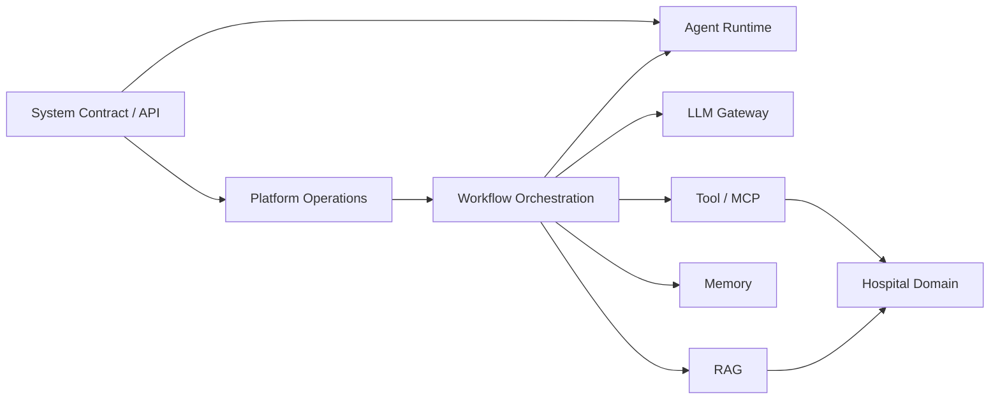

# Detailed Design — Hospital Agent Platform

- **Version:** 0.2
- **Status:** implementation design baseline
- **Scope:** MVP v1.0 with explicit Reliability v1.1 extensions
- **Sources:** [requirements](requirement.md), [HLD](architecture.md), [accepted ADRs](adr/README.md)

The design is organized by module and bounded context. Each document states what it owns, its interfaces, data, invariants, failure handling, and verification. Cross-module rules are defined once in [System Contract](design/system-contract.md). Hospital data and patient identities in this project are synthetic; the application provides administrative guidance only. Demo configuration values are not production targets.

| Design | Owns | Key contract |
|---|---|---|
| [System Contract](design/system-contract.md) | HTTP, actor/tenant context, common types, request idempotency, policy interface | `202` only after durable admission; default-deny access |
| [Agent Runtime](design/agent-runtime.md) | Execution state, checkpoints, events, attempts, waiting requests, CAS | One committed transition per expected version |
| [Workflow Orchestration](design/workflow-orchestration.md) | Workflow graph, scheduler, jobs, retries, worker claims/leases | At-least-once processing from PostgreSQL work intents |
| [LLM Gateway](design/llm-gateway.md) | Provider adapters, prompt/model versions, structured output, stub | Model output is data, never authority |
| [Tool/MCP](design/tool-mcp.md) | Tool contracts, policy gate, invocation ledger, reconciliation | Stable operation ID and remote lookup for effects |
| [Memory](design/memory.md) | Tenant-scoped conversation context | Chat changes cannot alter workflow progress |
| [RAG](design/rag.md) | Approved document retrieval and citation validation | Evidence is versioned, current and tenant-scoped |
| [Hospital Domain](design/hospital-domain.md) | Procedures, locations, appointments, handoffs, patient service queue | Domain effects are atomic and idempotent in mock service |
| [Platform Operations](design/platform-operations.md) | Deployment, tenancy, admission, telemetry, migrations, release gates | Capacity and recovery work across replica boundaries |

## Boundary rules

- Runtime owns authoritative execution progress; orchestration decides the next declared step; Tool/MCP owns external effect protocol; Hospital Domain owns hospital business state.
- Memory is replaceable LLM context. RAG is approved evidence. Neither is an execution checkpoint or an authorization source.
- Platform work jobs and hospital patient service numbers have separate schemas, states and permissions.
- Each execution pins workflow, prompt, model, policy, tool-contract and hospital configuration versions through completion.
- MVP uses one worker deployment and direct PostgreSQL job claims. Multi-replica leases/fencing, tenant quotas and patient service queues are v1.1.

## Implementation order

1. System Contract, Agent Runtime and Workflow Orchestration: durable admission, state CAS, waiting, retries and restart recovery.
2. Tool/MCP and Hospital Domain: policy-gated mock booking, stable operation IDs and uncertain-outcome reconciliation.
3. LLM Gateway, Memory and RAG: schema-validated generation, separate chat context, approved sourced guidance and abstention.
4. Platform Operations: observability, fault tests and the MVP safety gate; then v1.1 replicas, tenants, quotas and service queue.

Before enabling the hospital workflows, maintainers must provide approved synthetic fixtures, staff-routing/fallback wording, a qualified review of the versioned warning-indicator suite, and a retrieval evaluation set for the similarity threshold. These are content and evaluation inputs. The runtime modules can be implemented independently.
